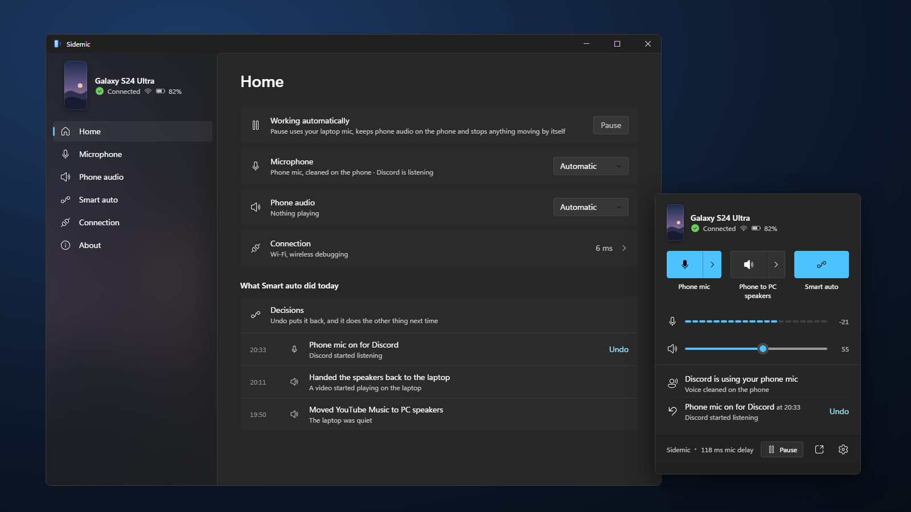
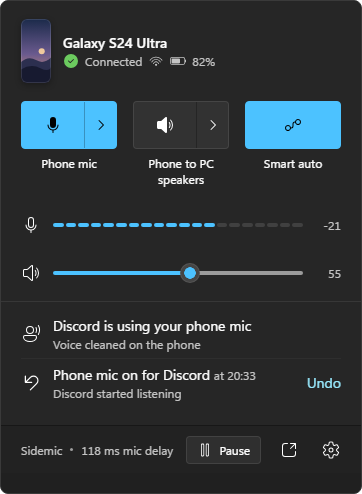
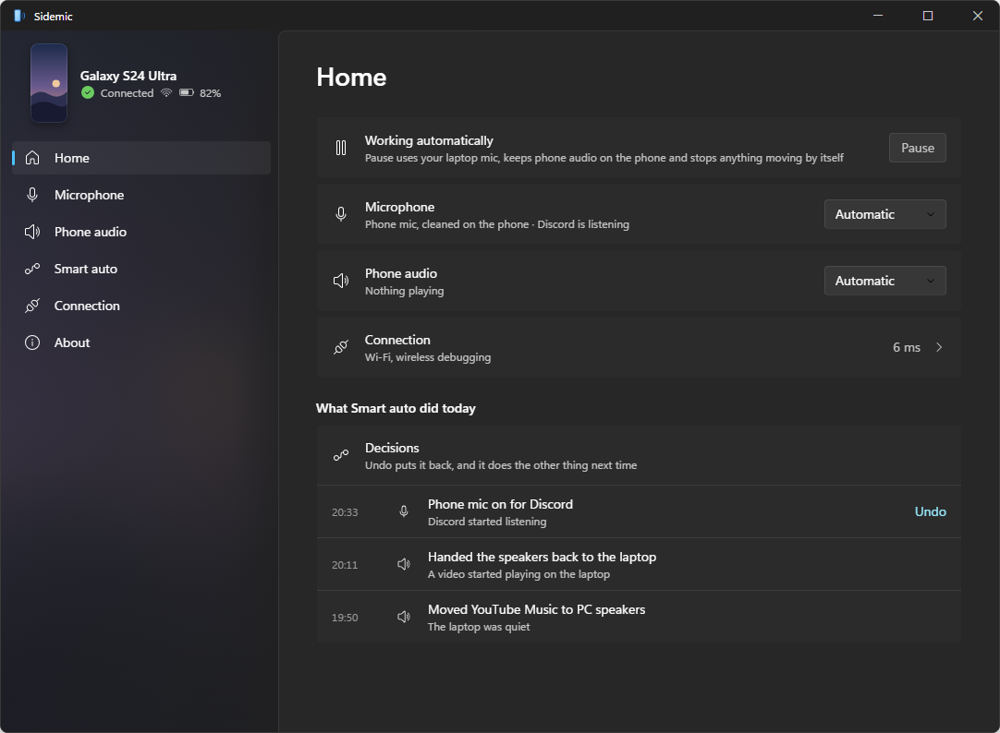
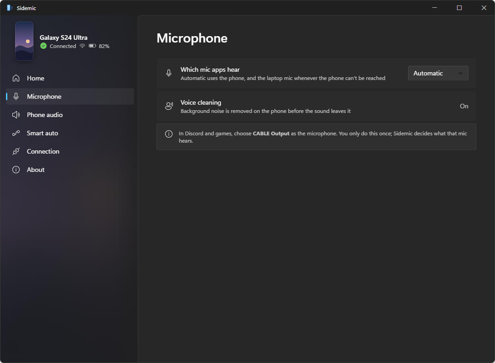
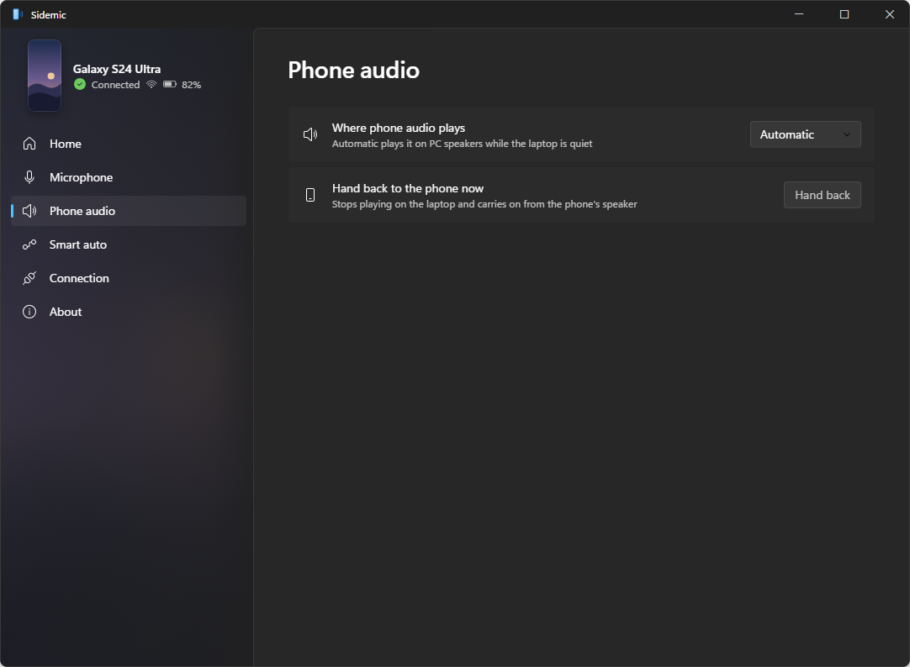
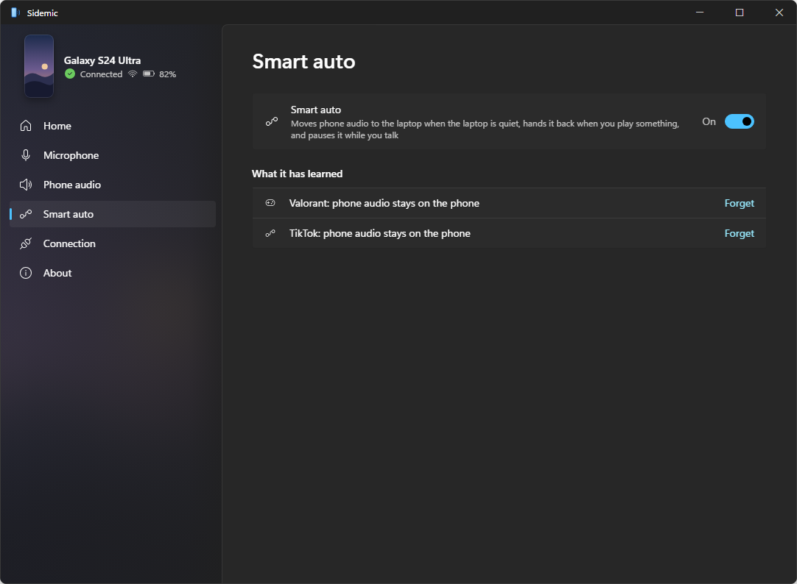
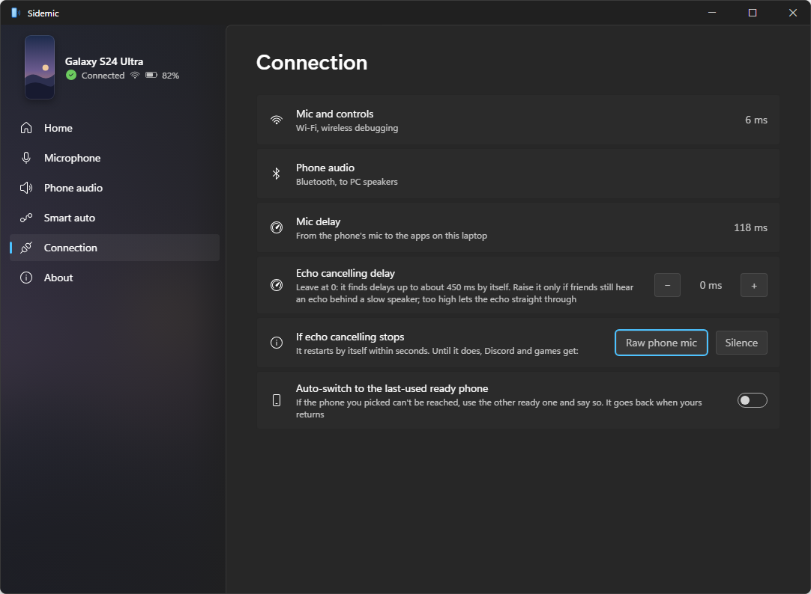
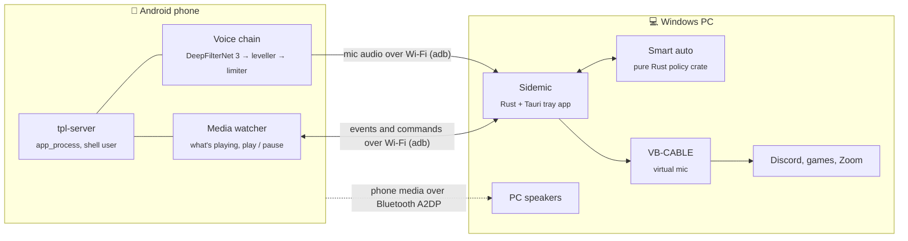

<div align="center">


# Sidemic

**Your Android phone becomes your PC's microphone, and your phone's music plays on your PC speakers.**<br>
Wireless, automatic, and nothing to install on the phone.

[](#requirements)
[](#requirements)
[](https://www.rust-lang.org/)
[](https://tauri.app/)
[](LICENSE)
[](https://github.com/Sohwhat6420/true-phone-link/actions/workflows/test.yml)
[](#roadmap)



[What it does](#what-it-does) ·
[How it works](#how-it-works) ·
[Getting started](#getting-started) ·
[Numbers](#the-numbers) ·
[Roadmap](#roadmap) ·
[Build from source](#build-from-source)

</div>

---

**Why it's interesting, in four numbers** (all measured; method under [The numbers](#the-numbers)):

| | |
| --- | --- |
| **0** apps installed on the phone | The PC pushes a small Java server over wireless adb and runs it with `app_process` as the shell user (the trick scrcpy uses) |
| **1.15 → 2.83** voice quality (DNSMOS overall) | DeepFilterNet 3 noise removal runs **on the phone's CPU**, 3.9 ms per 10 ms block, so the PC spends nothing on it |
| **~9 MB, 0.03% CPU** idle in the tray | Down from ~800 MB and a whole core, fixed one API call at a time ([write-up](docs/efficiency.md)) |
| **77** automated tests | Smart auto is a pure Rust state machine (events in, actions out) with table-driven scenarios; CI runs them on every push |

**Quick start** (build from source; Windows 11, Rust, Node 18+):

```bash
git clone https://github.com/Sohwhat6420/true-phone-link && cd true-phone-link
cargo test -p tpl-policy   # Smart auto's 15 scenario tests: no phone, no Android SDK
```

The full app also needs the Android SDK for the phone side: see [Build from source](#build-from-source).

## Why

Laptop microphones are bad, and the phone in your pocket has four good ones and a Snapdragon to clean them up.
The apps that let you use it as a PC mic tend to show adverts, stop after an hour, or need you to open something
on the phone every time.

Sidemic sits in the Windows tray and just does it. When Discord or a game opens the mic, your phone's mic
goes live; when it closes, it switches off. If you start music on your phone while the laptop is quiet, it moves to
your PC speakers, and it moves back when you play something on the laptop. You don't touch either device.

## What it does

<table>
<tr>
<td width="50%" valign="top">

### 🎙️ Phone as your PC mic
- Turns on by itself when any app starts listening, and off when it stops.
- Noise removal runs **on the phone** (DeepFilterNet 3), so your PC spends nothing on it mid-game.
- If the phone drops off, the laptop mic takes over, so you're never silent.

</td>
<td width="50%" valign="top">

### 🔊 Phone audio on your PC speakers
- Phone media plays through the PC's speakers over Bluetooth, with no re-pairing.
- Short laptop sounds (a Discord ping) briefly duck the phone instead of taking over.
- Real laptop media hands the speakers back, and the phone carries on playing on its own speaker.

</td>
</tr>
<tr>
<td width="50%" valign="top">

### 🧠 Smart auto that learns
- Sensible defaults, not hard-coded rules.
- Asks once per game whether phone audio may use the speakers, then remembers.
- Every decision is listed with an **Undo**, and undoing it teaches it the other way.

</td>
<td width="50%" valign="top">

### 🪶 Light enough to forget about
- Idle in the tray: **one process, ~9 MB, 0.03% CPU**.
- The flyout's web view loads on click and unloads after two minutes.
- Follows your Windows accent colour, and shows your phone's own wallpaper.

</td>
</tr>
</table>

## Screenshots

<table>
<tr>
<td align="center" width="36%"><br><sub><b>Tray flyout.</b> Click the icon: mic, speaker and Smart auto at a glance.</sub></td>
<td align="center"><br><sub><b>Home.</b> What it's doing, why, and what it did today.</sub></td>
</tr>
</table>

<details>
<summary><b>More screens</b></summary>
<br>

| Microphone | Phone audio |
| :---: | :---: |
|  |  |
| **Smart auto** | **Connection** |
|  |  |

</details>

<sub>Screenshots are rendered from the real UI files with a stubbed backend, so they carry no real device names or
addresses: `node docs/screenshots/render.mjs` rebuilds them.</sub>

## How it works



- **No phone app.** The laptop pushes a small server to the phone over wireless adb and runs it as the shell
  user with `app_process`, the same trick [scrcpy](https://github.com/Genymobile/scrcpy) uses. It stays warm, so
  the mic starts without clipping your first word.
- **Your apps never get reconfigured.** They use *CABLE Output* as their mic once, and Sidemic decides
  what feeds it: the phone, or the laptop's own mic as a fallback.
- **Phone media** uses Windows' own Bluetooth audio sink (`AudioPlaybackConnection`), which the app opens and
  closes itself.
- **Smart auto** is a separate crate with no I/O: events in, actions out, covered by 40 table-driven scenario cases.

## Getting started

> [!NOTE]
> Sidemic has been installed on the author's own laptop, with their phone, since 27 Oct 2026. There's no public installer
> yet; until v1 you [build it from source](#build-from-source).

### Requirements
- **Windows 11** with Bluetooth (for phone audio on the PC speakers).
- **[VB-CABLE](https://vb-audio.com/Cable/)**, the free virtual audio cable (donationware), used as the mic your apps
  pick.
- **adb** on the PC, from Android platform-tools (`winget install Google.PlatformTools`) or
  [scrcpy](https://github.com/Genymobile/scrcpy) (`winget install Genymobile.scrcpy`); the app finds either.
- **A 64-bit Android 12+ phone** with Developer options on. Tested on a Galaxy S24 Ultra (Android 16) and a POCO
  X6 Pro (HyperOS 2, Android 15); see [Phone compatibility](#phone-compatibility).
- Phone and PC on the same **private** Wi-Fi.

### One-time phone setup
1. Turn on **Developer options**: <kbd>Settings</kbd> → <kbd>About phone</kbd> → <kbd>Software information</kbd>
   → tap <kbd>Build number</kbd> seven times.
2. Turn on <kbd>Developer options</kbd> → <kbd>Wireless debugging</kbd>, and add its Quick Settings tile.
3. Pair once with `adb pair` (Developer options shows the code), and tick **Always allow on this network**.
4. Samsung phones: turn off **Auto Blocker**, and turn on **Disable adb authorisation timeout**.
5. Xiaomi, Redmi and POCO phones: also turn on <kbd>Developer options</kbd> → **USB debugging (Security settings)**.
   HyperOS may ask for a SIM card and a Mi account the first time you turn it on.
6. OPPO, realme and OnePlus phones: turn on **Disable permission monitoring** in Developer options.

#### Phone compatibility

| Phone | Software | Mic | Phone audio on the PC | What's playing, play/pause | Switches it needs |
| --- | --- | --- | --- | --- | --- |
| Samsung Galaxy S24 Ultra | One UI 8, Android 16 | ✅ | ✅ | ✅ | Wireless debugging; Auto Blocker off; Disable adb authorisation timeout |
| Xiaomi POCO X6 Pro 5G | HyperOS 2.0, Android 15 | ✅ screen on and off | not tested yet | ✅ (YouTube) | Wireless debugging; USB debugging (Security settings)¹ |
| Other Xiaomi, Redmi, POCO | HyperOS / MIUI | likely, untested | likely | likely | as the POCO |
| OPPO, realme, OnePlus | ColorOS / OxygenOS | untested | untested | untested | Wireless debugging; Disable permission monitoring² |
| Pixel and other stock Android 12+ | Android 12+ | untested | untested | untested | Wireless debugging |

¹ It was on for the POCO test; it wasn't tested off. If the phone refuses something, the app names this switch.
² From those brands' documentation, not measured here. The app names it if the phone refuses something.

Notes from the POCO test (17 Oct 2026):
- **Screen off**: the phone's Wi-Fi power saving sends the mic in bursts about 190 ms apart. The app measures how
  late the audio arrives and grows its buffer only as much as that needs (40 ms with the screen on, up to about
  240 ms with it off), so there's no gap, at the cost of some delay while the screen is off.
- **Wallpaper**: HyperOS doesn't let the PC read the wallpaper picture, so the app shows a gradient in its colours.
- **Bluetooth name**: the phone reports it only while Bluetooth is on. If it isn't known, the app's Bluetooth hint
  falls back to the phone's device name, then its model.
- **YouTube Music and Spotify** weren't tested (they need a signed-in account).

### Then
- Install and start Sidemic. It sits in the tray and starts with Windows.
- In Discord or your game, set the input device to **CABLE Output** once.
- That's it. After a phone restart, tap the **Wireless debugging** tile once and it reconnects.

> [!IMPORTANT]
> Right now **wireless debugging is the only way the PC reaches the phone.** That's what lets it run with no
> phone app, but it means Developer options. An optional companion app that needs neither is planned for v1
> (see the [roadmap](#roadmap)); the no-install route will stay.

> [!CAUTION]
> Wireless debugging gives any paired computer shell access to your phone. Only pair PCs you own, and only use it
> on networks you trust, such as home Wi-Fi.

<details>
<summary><b>Troubleshooting</b></summary>
<br>

| The flyout says | What to do |
| --- | --- |
| *Tap Wireless debugging on your phone* | The phone restarted or changed Wi-Fi, which switches wireless debugging off. Tap the tile. |
| *Allow this laptop on your phone* | Accept the prompt on the phone and tick **Always allow on this network**. Mesh Wi-Fi asks once per access point. |
| *adb isn't installed* | Install platform-tools or scrcpy (see [Requirements](#requirements)), or point `TPL_ADB` at `adb.exe`. |
| *Couldn't start on the phone* | It retries by itself. If it keeps failing, the log says why. |
| *The phone refused play/pause* (Connection page; also volume changes or reading what's playing) | Turn on the switch it names. On Xiaomi, Redmi and POCO that's **USB debugging (Security settings)**. |
| *Also reachable over wireless debugging: Use this phone* (Connection page) | More than one phone has wireless debugging on. The app keeps the phone it used before; click **Use this phone** to switch. |
| Your friends hear nothing | In Discord or the game, the input device must be **CABLE Output**, not your laptop mic. |

The app writes a plain-text log per day to `%APPDATA%\com.truephonelink.desktop\logs\`. If something looks
wrong, right-click the tray icon and choose **Mark a problem now**; the moment is flagged in the log.

</details>

## The numbers

All measured on the author's Acer Nitro laptop and Galaxy S24 Ultra in October 2026. Voice quality is Microsoft's
[DNSMOS](https://github.com/microsoft/DNS-Challenge/tree/master/DNSMOS) score of the same spoken take, recorded raw
and through the phone's voice chain.

<table>
<tr>
<td valign="top">

**Voice quality** (DNSMOS, 1–5, higher is better)

| | Raw phone mic | Sidemic |
| --- | :---: | :---: |
| Speech | 1.24 | **3.14** |
| Background | 1.17 | **3.90** |
| Overall | 1.15 | **2.83** |
| P.808 | 2.52 | **3.38** |

</td>
<td valign="top">

**Cost and speed**

| | |
| --- | --- |
| PC, idle in the tray | ~9 MB, 0.03% CPU |
| PC, flyout open | ~107 MB |
| Phone, idle | ~71 MB PSS, 0.2% of one core |
| Phone, mic live | 39% of one core |
| Mic delay, end to end | ~120 ms (32 ms on the phone) |

</td>
</tr>
</table>

The PC side once used ~800 MB and a whole core. [docs/efficiency.md](docs/efficiency.md) shows how that was found
and fixed, one API call at a time.

## Known limits

- **Echo.** When the laptop speakers play while the phone mic is live, the echo left after cancellation measured
  a mean of -43.6 dB against a -50 dB target (POCO X6 Pro, 26 Oct 2026); the cause isn't pinned down yet.
- **Wireless debugging is the only link**, so the phone needs Developer options and one tap on the tile after
  each restart (see the caution above).
- **Tested on two phones and one laptop.** Other phones are listed as untested in the compatibility table.
- **No signed installer yet.**

## Roadmap

- [x] Phone mic with on-phone noise removal, laptop-mic fallback
- [x] Phone media on the PC speakers, with hand-back and ducking
- [x] Smart auto with Undo and per-game memory
- [x] Tray flyout and full window, Windows accent and phone wallpaper
- [x] Pause / Resume, and recovery if the window ever stops responding
- [x] Installed on the author's laptop (since 27 Oct 2026)
- [ ] Home-screen control panel on the phone (a web app, nothing to install)
- [ ] **Optional companion app** for v1: no Developer options, no tap after a phone restart, and a Quick
      Settings tile
- [ ] Bluetooth-tethering fallback when the phone's Wi-Fi is off
- [ ] Reverse audio (PC sound to the phone or earbuds)
- [ ] Signed installer and first public release

## Build from source

<details>
<summary><b>Toolchain and commands</b></summary>
<br>

You need Rust (MSVC), Node 18+, JDK 17 and the Android SDK (`platforms;android-36`, `build-tools;36.0.0`, NDK 29),
plus [`cargo-ndk`](https://github.com/bbqsrc/cargo-ndk).

```bash
# 1. The phone server (javac + d8, no Gradle)
bash phone-server/build.sh

# 2. The voice chain for the phone (DeepFilterNet 3, loaded over JNI)
cargo ndk -t arm64-v8a build --release -p tpl-voice-jni
cp target/aarch64-linux-android/release/libtpl_voice_jni.so phone-server/out/

# 3. The Windows app and its installer
cd apps/desktop
npx @tauri-apps/cli@2 build

# Smart auto's scenario tests
cargo test -p tpl-policy
```

To try the phone server by hand:

```bash
adb shell mkdir -p /data/local/tmp/tpl
adb push phone-server/out/tpl-server.jar /data/local/tmp/tpl/
adb shell CLASSPATH=/data/local/tmp/tpl/tpl-server.jar app_process / com.truephonelink.server.Main mode=probe
```

</details>

<details>
<summary><b>Repository layout</b></summary>
<br>

| Path | What it is |
| --- | --- |
| `apps/desktop/` | The Windows tray app (Rust + Tauri 2). `src-tauri/src/core.rs` runs everything; `ui/` is the flyout and window |
| `crates/policy/` | Smart auto: a pure state machine with scenario tests |
| `crates/voice/` | The voice chain: DeepFilterNet 3 or RNNoise, leveller, look-ahead limiter |
| `crates/voice-jni/` | The JNI bridge that runs the voice chain inside the phone server |
| `crates/voice-bench/` | Offline A/B bench used to pick the chain |
| `phone-server/` | The server run on the phone: mic capture, media watcher, wallpaper, control channel |
| `docs/` | Write-ups, starting with [efficiency](docs/efficiency.md) |

</details>

## Credits

- [scrcpy](https://github.com/Genymobile/scrcpy) (Apache-2.0), whose `app_process` approach and some code the
  phone server builds on; see [NOTICE](NOTICE).
- [DeepFilterNet](https://github.com/Rikorose/DeepFilterNet) for speech enhancement, and
  [VB-CABLE](https://vb-audio.com/Cable/) for the virtual mic.
- Icons from Microsoft's [Fluent UI System Icons](https://github.com/microsoft/fluentui-system-icons) (MIT).

## Licence

[Apache-2.0](LICENSE).
